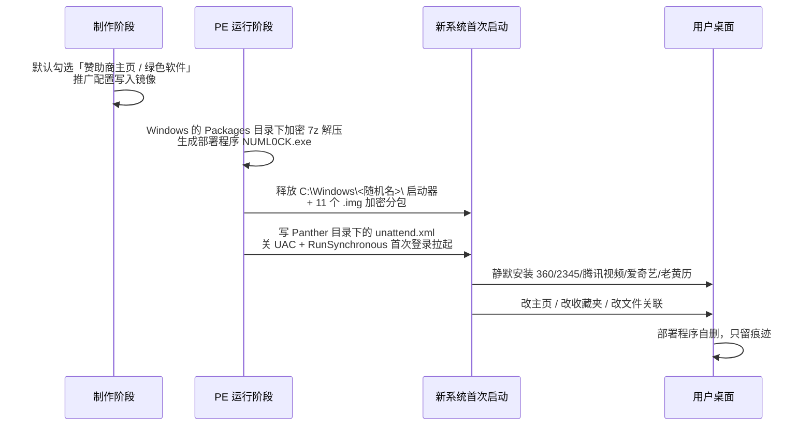

# DBC Sweeper

**大白菜 PE 装机残留的专项排查与可逆清理工具。**

针对「用大白菜 U 盘装完系统后，桌面多出一堆 360 / 2345 / 腾讯视频 / 爱奇艺 / 老黄历，浏览器主页被改成 hao123 或 2345 导航，每天第一次开浏览器还自动多出一个推广标签，卸载完过几天又复活」这类问题。

单文件 PowerShell，**默认纯只读**，写操作四道闸、逐项确认、全程可回滚。不删文件，只移动到隔离区。


---

## 目录

- [这是什么](#这是什么)
- [它凭什么判断](#它凭什么判断)
- [快速开始](#快速开始)
- [报告长什么样](#报告长什么样)
- [结果分级](#结果分级)
- [参数与用法](#参数与用法)
- [五层检查项](#五层检查项)
- [写模式究竟改了什么](#写模式究竟改了什么)
- [安全设计](#安全设计)
- [它刻意不做的事](#它刻意不做的事)
- [植入机理](#植入机理)
- [浏览器三层劫持](#浏览器三层劫持)
- [特征库与自定义](#特征库与自定义)
- [治本方案](#治本方案)
- [常见问题](#常见问题)
- [仓库结构](#仓库结构)
- [环境与兼容性](#环境与兼容性)
- [开发笔记](#开发笔记)
- [情报来源与可信度](#情报来源与可信度)
- [免责声明](#免责声明)
- [许可](#许可)

---

## 这是什么

一句话：**它不猜"这个软件像不像流氓"，而是查"这台机器有没有被 PE 部署过的痕迹"。**

市面上大多数清理工具靠软件名单和启发式打分，遇到装机推广就失效——360 浏览器本身是合法软件，2345 导航本身是合法网站，单看任何一个都不像病毒。但这个组合出现在一台刚装完系统、还没装任何东西的电脑上，就只可能是 PE 植入的。

本工具的判定逻辑是**痕迹导向**：

| 普通清理工具 | DBC Sweeper |
|---|---|
| 这个进程像不像恶意程序 | 这台机器有没有 `Panther\unattend.xml` 部署痕迹 |
| 这个软件口碑好不好 | 这个软件是不是在**系统安装当天 ±3 天**内装的 |
| 扫文件特征码 | 查注册表里的**推广渠道号**（`HKLM\SOFTWARE\DaBaiCai\Soft`） |
| 删掉就完事 | 记录每个动作的回滚路径，事后能一键还原 |
| 建议重装系统 | 先取证，再决定要不要重装 |

适合谁用：

- 刚用大白菜 / 老毛桃 / 电脑店 / 晨枫 / U深度 装完系统，想一次性弄干净
- 已经用了一段时间，只想清广告不想重装
- 想确认某台机器到底有没有被植入过（**买二手电脑、接手别人电脑时特别有用**）
- 帮别人修电脑，需要一个能出报告、能自证没乱动的工具

---

## 它凭什么判断

五层取证模型，从源头查到残留：


每一层都有对应的**硬指标**，不是"疑似"：

| 层 | 硬指标 | 为什么可信 |
|---|---|---|
| A | `HKLM\SOFTWARE\DaBaiCai` 下的 `Soft` 子键，记录 `2345explorer=511097`、`360se=5000783` 这类渠道号 | 这是装机工具自己写下的推广分成账本，正常软件不会写 |
| B | `C:\Windows\Panther\unattend.xml` 的写入时间**等于系统安装时间**，且含 `RunSynchronousCommand` + `ConsentPromptBehaviorAdmin=0` | 无人值守文件是部署期产物，微软官方安装不带 |
| B | `C:\Windows\<随机名>\` 下成组的 `.img` / `.ext` 分包 | 公开逆向样本里是 11 个加密分包，跑完自删 |
| C | 软件安装日期落在系统安装日 ±3 天内，且发布者未知 | 刚装完的系统不可能自带这些 |
| D | 浏览器安装目录下的 `initial_preferences` | **Edge/Chrome 官方安装不带这个文件**，它是首次运行配置 |

---

## 快速开始

### 1. 下载

```powershell
git clone https://github.com/<your-name>/DBC-Sweeper.git
cd DBC-Sweeper
```

或者点右上角 **Code → Download ZIP** 解压。

### 2. 只读排查（零改动，先看报告）

双击：

```
scripts\RUN_1_Scan.cmd
```

约 10 秒，报告生成在 `scripts\DBC_Sweeper_Report\`：

```
report.html      ← 双击用浏览器打开，人看的
findings.json    ← 机器读的，方便前后对比
ioc_db.json      ← 本次使用的特征库快照
```

> 这一步**不会删除、修改、禁用任何东西**，只读注册表、读文件、读浏览器配置。

### 3. 看报告，再决定要不要清

报告第一屏就是结论：

```
综合判断：多项证据吻合，置信度高
Safe 6 ｜ Review 13 ｜ Protect 2
```

如果 `Safe` 是 0，说明没有强特征命中，不需要往下做。
如果有 `Safe` 项，再按 [写模式](#参数与用法) 逐项处理。

---

## 报告长什么样

[`examples/report-sample/report.html`](examples/report-sample/report.html) 是一次真实扫描的产物，可以直接用浏览器打开看。结构：

| 章节 | 内容 |
|---|---|
| 综合判断 | 置信度 + 一句话结论（多因子投票，不是拍脑袋） |
| KPI | Safe / Review / Protect 三档计数 |
| 分级表 | 阶段 / 类别 / 对象 / 说明 / 建议动作 |
| 执行记录 | 写模式下本次实际做了什么 + 回滚方式 |
| 植入链路 | 六个阶段对应到本机的落地痕迹 |
| 工具边界 | 做了什么、没做什么、哪里不完美 |
| 情报来源 | 来源列表 + 可信度分级 + 已排除的不实信息 |

`findings.json` 单条结构：

```json
{
  "Stage": "B 部署期",
  "Level": "Safe",
  "Category": "随机名载荷目录",
  "Name": "Vmaprlfxn（含加密分包）",
  "Detail": "命中 10 个 .img/.ext 分包，合计 450.3 MB；exe 0 个",
  "Path": "C:\\Windows\\Vmaprlfxn",
  "Action": "系统目录，工具不代删；确认后建议在 PE 下处理",
  "SizeMB": ""
}
```

前后对比很简单：把清理前后两次的 `findings.json` 按 `Path` 做 diff，就知道清掉了什么、有没有复活。

---

## 结果分级

工具只给三档，不给"风险评分"这种模糊玩意：

| 级别 | 含义 | 工具行为 | 你该做什么 |
|---|---|---|---|
| **Safe** | 命中强特征，可判定为推广 / 劫持 | 写模式下可处理 | 确认后清理 |
| **Review** | 需要你判断（可能是你自己装的） | 只报告 | 自己认一遍，别全删 |
| **Protect** | 工具绝不处理 | 只报告 | 不用管，或按建议手工处理 |

**综合置信度**：`Safe ≥ 4` → 高；`Safe 1–3` → 中；`Safe 0` → 低。

为什么 Review 不自动清？因为 `Review` 里混着你自己装的工业软件、开发工具、串口驱动。把它们当广告删了，代价远大于留一个广告。

---

## 参数与用法

### 四个启动器

| 启动器 | 权限 | 作用 | 风险 |
|---|---|---|---|
| `RUN_1_Scan.cmd` | 普通 | 只读排查，出报告 | 无 |
| `RUN_2_Fix.cmd` | 管理员 | 可逆修复（改名 / 移动 / 注释 / 禁用） | 低，全备份 |
| `RUN_3_Quarantine.cmd` | 管理员 | 推广目录、载荷目录移入隔离区 | 中，可移回 |
| `RUN_4_PurgeReg.cmd` | 管理员 | 删推广注册表键（先导 `.reg`） | 中，可导入还原 |

`RUN_2/3/4` 会自动弹 UAC 请求提升权限，不用手动开管理员终端。

### 直接调用脚本

```powershell
# 只读（默认行为，可省略 -Scan）
powershell -NoProfile -ExecutionPolicy Bypass -File .\scripts\DBC_Sweeper.ps1

# 可逆修复
powershell -NoProfile -ExecutionPolicy Bypass -File .\scripts\DBC_Sweeper.ps1 -Fix -IAcknowledge

# 隔离目录（单批默认 10 个）
powershell -NoProfile -ExecutionPolicy Bypass -File .\scripts\DBC_Sweeper.ps1 -Quarantine -IAcknowledge

# 删注册表键（逐个导出 .reg）
powershell -NoProfile -ExecutionPolicy Bypass -File .\scripts\DBC_Sweeper.ps1 -PurgeReg -IAcknowledge
```

### 参数表

| 参数 | 说明 |
|---|---|
| （无） / `-Scan` | 纯只读，默认行为 |
| `-Fix` | 可逆修复。需 `-IAcknowledge` + 管理员 + 交互控制台 |
| `-Quarantine` | 把推广目录、随机名载荷目录、`unattend.xml` 移入隔离区 |
| `-PurgeReg` | 删除明确属于推广渠道的注册表键，删前逐个导出 `.reg` |
| `-IAcknowledge` | 写操作的显式确认开关。缺它 → `exit 1` |
| `-Measure` | 统计相关目录体积（慢一些，但能看清 450 MB 那种大头） |
| `-SkipBrowser` | 跳过 D 层浏览器检查（只想看系统层时用） |
| `-OutDir <路径>` | 报告输出目录，默认 `<脚本目录>\DBC_Sweeper_Report` |
| `-MaxBatch <n>` | `-Quarantine` 单批上限，默认 10 |

### 推荐执行顺序

```powershell
# 1. 先只读，看清楚
.\scripts\RUN_1_Scan.cmd

# 2. 修复浏览器与启动项（最安全的一档）
.\scripts\RUN_2_Fix.cmd

# 3. 隔离确认过的推广目录
.\scripts\RUN_3_Quarantine.cmd

# 4. 最后才动注册表
.\scripts\RUN_4_PurgeReg.cmd

# 5. 重跑只读，确认 Safe 归零
.\scripts\RUN_1_Scan.cmd
```

**顺序不要反。** 先删注册表再修浏览器，浏览器里的会话文件会把推广标签写回来；先隔离目录再禁用启动项，计划任务会把软件重新下回来。

每个参数的完整行为、输出结构、失败处理，见 [`docs/04-tool-reference.md`](docs/04-tool-reference.md)。

---

## 五层检查项

| 层 | 检查内容 |
|---|---|
| **0 环境** | 系统版本 / 安装日期、UAC 状态（`EnableLUA`、`ConsentPromptBehaviorAdmin`）、管理员令牌、磁盘余量、是否在 PE 环境 |
| **A 源头** | 制作工具安装目录与卸载项、`HKLM\SOFTWARE\DaBaiCai` + `Soft` 渠道号、U 盘载荷特征文件（`DBC8x64.ISO`、`DBCMenu`、`PETools`、`fb.cfg`）、硬盘上的装机 ISO 与 `D:\大白菜PE` |
| **B 部署期** | `Panther\unattend.xml` 字段打分、`C:\Windows\<随机名>` + `.img/.ext` 分包、系统盘根随机名目录、`NUML0CK` 残留、伪装成系统组件的计划任务 |
| **C 落地** | 装机窗口内新装软件（按发布者白名单过滤大厂）、推广目录、推广注册表键、服务 / 驱动、Run / RunOnce、启动文件夹、快捷方式尾巴、hosts、系统代理（只报告）、收藏夹预置链接、文件与协议关联、WMI 事件订阅 |
| **D 浏览器** | `initial_preferences`、`Preferences.session`、`Sessions\*`、`Code Cache\js`、策略键、通知权限、扩展、默认搜索、主页 |
| **E 残留** | `Windows.old` / `$Windows.~BT`、`Windows\Temp`、驱动包、回收站 |

单个脚本约 1,800 行，全部逻辑可读可改，没有二进制、不联网。

---

## 写模式究竟改了什么

写模式只做**可逆**的动作，每一项都先备份：

| 动作 | 目标 | 怎么还原 |
|---|---|---|
| 改名 | `initial_preferences` → `initial_preferences.dbc_bak` | 改回原名 |
| 重写（改名失败时降级） | 只清 `homepage` / `homepage_is_newtabpage` / `session.restore_on_startup` / `session.startup_urls` 四个字段 | 用 `Backup_*\*_Preferences.bak` 覆盖 |
| 移动 | `Sessions\Tabs_*`、`Code Cache\js\*`、收藏夹 `.url` | 从 `Quarantine_*` 移回 |
| 删除注册表值 | Run / RunOnce 里的推广项 | 双击 `Backup_*\Run_*.reg` |
| 禁用任务 | 命中推广特征的计划任务 | `Enable-ScheduledTask` 或导入 `Backup_*\Task_*.xml` |
| 改快捷方式 | 清掉「目标」里被追加的网址 | 用 `Backup_*\*.lnk` 覆盖 |
| 注释 hosts | 加 `# [DBC-Sweeper] ` 前缀 | 用 `hosts.dbc_bak` 覆盖 |
| 改通知权限 | 推广站点 `setting` 改为 2（阻止） | 用 `Backup_*\*_Preferences.bak` 覆盖 |
| 移动目录 | 推广软件目录 / 随机名载荷 / `unattend.xml` | 从 `Quarantine_*` 移回 |

### 隔离 ≠ 删除 ≠ 释放空间

工具**一次 `Remove-Item` 都不用**，全部 `Move-Item` 到 `Quarantine_<时间戳>\`。

- 好处：误判可以完全恢复。
- 代价：**清空隔离区之前，磁盘空间一点没释放。**

确认没问题后，自己手动删掉 `Quarantine_*` 目录，空间才回来。这个决定权工具不替你做。

---

## 安全设计

写模式要过四道闸，任何一道不过就 `exit 1`：

```
闸 1  缺 -IAcknowledge                   → exit 1（打印正确调用方式）
闸 2  非交互会话 / -NonInteractive       → exit 1（防无人值守误操作）
闸 3  非管理员                            → exit 1（提示右键管理员运行）
闸 4  每个具体动作单独 Read-Host，必须输大写 YES
```

四道闸都做过实测，不是写在文档里的承诺：

```text
=== GATE 1: -Fix 无 -IAcknowledge ===
[已拒绝] 写操作需要显式确认...
EXIT1=1
=== GATE 2: -Fix -IAcknowledge 但非交互 ===
[已拒绝] 检测到非交互会话...
EXIT2=1
=== GATE 3: -Quarantine -IAcknowledge 非交互 ===
[已拒绝] 检测到非交互会话...
EXIT3=1
```

### 为什么是 `exit` 而不是 `throw`

PowerShell 5.1 里 `$ErrorActionPreference = 'SilentlyContinue'` **会把 `throw` 一起吞掉**，脚本继续往下执行——安全闸形同虚设。

这个坑是实测踩出来的：最初四道闸全用 `throw`，测试时发现无论怎么调用都能继续跑。改成 `exit 1` 硬退出后，闸才真正生效。脚本里也刻意不再全局设 `SilentlyContinue`，改用各 cmdlet 自己的 `-ErrorAction`。

---

## 它刻意不做的事

这些不是"还没做"，是**决定不做**：

- **不删任何文件**。一律移动到隔离区，把最终决定权留给你。
- **不碰 `Secure Preferences`**。该文件受 MAC 校验保护，手改会导致配置被重置或校验失败。
- **不碰组策略键、UAC、系统服务、驱动**。这些可能承载其他合法策略，误改的代价远大于一个广告。
- **不碰 `C:\Windows\<随机名>` 和 `unattend.xml`**。都在系统目录，且可能是正常的 OEM 部署配置。`-Quarantine` 才动，且要逐项 YES。
- **不自动卸载软件**。卸载向导有挽留陷阱（"再想想""只留浏览器"），机器判断不如人看一眼。
- **不碰 `Windows.old`**。删除后无法回滚旧系统，用「设置 → 系统 → 存储 → 临时文件 → 删除以前版本的 Windows」更安全。
- **不碰代理设置**。用开发代理、公司代理、局域网代理的人不少，工具只报告不修改。
- **不联网**。没有遥测、没有云查杀、没有自动更新。全部逻辑在本地。

---

## 植入机理

推广软件不是"装完才混进来的"，而是**制作 U 盘时就把推广包写进了 PE 镜像**，系统首次启动时自动释放。



关键结论：

1. **用微软原版纯净 ISO 同样会中招。** 脏的是 PE，不是 ISO。很多人换了原版镜像还是弹广告，就是因为启动盘没换。
2. **装完再删只是治标。** 同一支 U 盘下次装还复发。
3. **痕迹是可查的。** 部署程序会自删，但 `unattend.xml` 的时间戳、注册表里的渠道号、`C:\Windows\<随机名>` 的分包都留着。

完整的五阶段机理、`unattend.xml` 字段含义、四个硬指标的判读标准，见 [`docs/01-mechanism.md`](docs/01-mechanism.md)。

---

## 浏览器三层劫持

这是最容易漏的一层。很多人把主页改成新标签页、重启还是弹，就是因为只改了第一层。

```
① 策略层   HKLM/HKCU\SOFTWARE\Policies\...\Edge|Chrome
           HomepageLocation / RestoreOnStartup / RestoreOnStartupURLs

② 配置层   <InstallDir>\initial_preferences      ← 官方安装不带这个文件
           User Data\<Profile>\Preferences
           session.startup_urls / homepage

③ 会话层   User Data\<Profile>\Sessions\Tabs_*
           冷启动恢复会话，把旧标签原样带回来
```

排查顺序 **① → ② → ③**，症状对应关系：

| 症状 | 通常在哪层 |
|---|---|
| 每次打开都跳固定网址，设置里改不掉 | ① 策略层 |
| 设置里看着是新标签页，但打开还是跳 | ② 配置层 |
| **只有每天第一次打开才弹**，当天再开就正常 | ③ 会话层 |
| 已经改成新标签页了，第二天又变回去 | ③ 会话层 + 后台常驻进程写回 |

### 第 ③ 层的两个坑

**坑一：必须先退干净浏览器。**
Edge 有后台常驻（`--no-startup-window --win-session-start`），任务管理器里看着关了，进程还在。退出时它会把当前标签写回 `Sessions\Tabs_*`，你刚删的文件又回来了。

正确做法：地址栏输 `edge://quit`，再到任务管理器确认 `msedge.exe` 进程数 **= 0**。

**坑二：光改设置没用。**
`Sessions\Tabs_*` 是二进制文件，里面存着完整标签列表。只改「启动时打开新标签页」，冷启动恢复会话时照样把旧标签带出来。必须把含推广网址的会话文件移走。

工具的做法：扫描时先枚举，`-Fix` 执行时**当场重新枚举**（不依赖扫描快照），逐个读二进制内容匹配推广域名，命中就移到 `Quarantine_*\Sessions\`。

---

## 特征库与自定义

**重要：特征库定义在脚本里，不是 `ioc_db.json`。**

```powershell
# scripts\DBC_Sweeper.ps1 第 204 行起
$script:IOC = [ordered]@{
    DomainRx      = '(?i)(2345\.com|2354mt\.com|hao123\.com|...)'
    BrowserUrlRx  = '(?i)(2345\.com|2354mt\.com|by\.[0-9a-z]{4,8}\.)'
    ProcRx        = '(?i)(^|\\)(2345Update|360Safe|360se|...)'
    PromoDirNames = @('360','360Safe','2345Soft','kuwo','iqiyi',...)
    RegRoots      = @('HKCU:\Software\2345.com',...)
    ToolNames     = @('DaBaiCai','大白菜','LaoMaoTao','老毛桃',...)
    UsbMarks      = @('DBC8x64.ISO','DBCMenu','PETools','fb.cfg',...)
    PayloadExt    = @('.img','.ext')
    FirstRunFiles = @('initial_preferences','master_preferences')
    PolicyKeys    = @('HKLM:\SOFTWARE\Policies\Microsoft\Edge',...)
    WhiteList     = @('Microsoft','Python','PlatformIO','CH340',...)
}
```

`ioc_db.json` 是**导出快照**，用来对照和版本管理，改它不会改变扫描行为。要增补特征，改 `$script:IOC`。

### 加一条自己的特征

比如你发现新版推广用了 `by.xxxxx.cn` 这种随机二级域名跳转：

```powershell
# 1. 打开 scripts\DBC_Sweeper.ps1，找到 $script:IOC
# 2. 在 BrowserUrlRx 里加分支
BrowserUrlRx = '(?i)(2345\.com|2354mt\.com|hao123\.com|999\.com|by\.[0-9a-z]{4,8}\.)'

# 3. 只读跑一遍，确认命中符合预期、没有误报
powershell -NoProfile -ExecutionPolicy Bypass -File .\scripts\DBC_Sweeper.ps1
```

### 加白名单

工具白名单默认保护 `Microsoft`、`Python`、`PlatformIO`、`Arduino`、`Code`、`CH340`、`CP210`、`FTDI`、`Espressif`、`Intel`、`NVIDIA`、`AMD` 等。

如果你装的东西被误判成 Review，往 `WhiteList` 里加发布者名即可。**白名单只影响是否判 Safe，不会让工具完全忽略该对象**——这是刻意的，避免白名单变成盲区。

IOC 全表（注册表 / 目录 / 服务 / 驱动 / 进程 / 域名 / 浏览器）与五条真实误报来源，见 [`docs/02-ioc-library.md`](docs/02-ioc-library.md)。

---

## 治本方案

工具解决"这一台"。要彻底不复发，得从启动盘下手。

### 方案一：去源头取消赞助商（继续用大白菜）

1. 打开大白菜制作器 → **个性设置** → **支持我们**
2. 取消全部推广勾选（赞助商主页、绿色软件）
3. **必须点「保存设置」**，否则不生效
4. **重新制作一次 U 盘**

取消密码按版本不同：

| 版本 | 取消方式 |
|---|---|
| 老版本 | 输入 `winbaicai.com`（UEFI 版 `bigbaicai.com`） |
| v6.0_2002 起 | 点「我要狠心取消」→ 复制机器码 → 关注公众号换解锁码 → 填入保存 |

两个坑：

- **改完不点保存 = 没改。**
- **已经做好的 U 盘不会自动变干净**，必须重新制作。

### 方案二：换工具（更省心）

- 微PE（WePE）—— 公认干净，无推广
- 优启通（EasyU）—— 干净，功能全
- 微软官方媒体创建工具 + Rufus 写原版 ISO

代价是部分机型可能要自己补驱动（尤其 NVMe 和网卡）。建议从主板 / 品牌官网下，别用"万能驱动包"——那玩意本身经常带推广。

分场景的完整操作步骤（S0 准备装系统 / S1 刚装完 / S2 已用很久 / S3 只有浏览器弹广告 / S4 清了又复活 / S5 只想确认 / S6 帮别人修），见 [`docs/03-manual-guide.md`](docs/03-manual-guide.md)。

### 方案三：进桌面之前清

如果不想重做 U 盘，可以在 PE 环境下、系统首次启动**之前**，先删掉 `C:\Windows\Panther\unattend.xml` 和 `C:\Windows\<随机名>\` 目录。这样首次启动时没有东西来拉起安装程序。

**注意：** 这一步在 PE 里做，且必须先确认那个随机名目录确实是载荷（工具的报告会告诉你里面有几个 `.img`、多大）。删错了可能影响系统首次配置。

---

## 常见问题

<details>
<summary><b>Q：报告里 Safe 是 0，是不是就没问题？</b></summary>

不一定。Safe 为 0 只说明**没命中已知强特征**。可能是：这台机器确实干净；或者是新版变体改了特征（比如换了随机域名）；或者你在 `-SkipBrowser` 模式下跳过了浏览器层。

看报告里的「综合判断」和 Review 项，别只看 Safe 计数。
</details>

<details>
<summary><b>Q：Review 项能不能全删？</b></summary>

不建议。Review 里通常混着你自己装的软件、开发工具、串口驱动、系统设置。逐条看「说明」列，确认不是自己装的再动。

本机实测的 13 项 Review 里，6 项是用户的工业软件和开发工具，2 项是系统设置，只有 5 项是需要处理的残留。
</details>

<details>
<summary><b>Q：为什么隔离完磁盘空间没变？</b></summary>

因为工具不删文件，只 `Move-Item` 到 `Quarantine_<时间戳>\`。**移动文件不释放空间**（同一分区内只是改了目录项）。

确认没问题后手动删掉 `Quarantine_*` 目录，空间才回来。单这一项可能就是几百 MB 到几个 GB。
</details>

<details>
<summary><b>Q：清完过几天又出现了？</b></summary>

三个可能：

1. **会话层没清干净** —— 浏览器后台进程把标签写回去了。先 `edge://quit`，确认进程数 0，再重跑 `-Fix`。
2. **计划任务没禁用** —— 有任务在定时重新下载。查 `taskschd.msc`。
3. **安全软件的「主页锁定」** —— 360、腾讯电脑管家自己有主页保护功能，它会把你的修改"还原"回去。先关掉那个功能再改。
</details>

<details>
<summary><b>Q：杀毒软件报毒 / Defender 拦截怎么办？</b></summary>

大概率是**误报**，因为工具的行为模式很像恶意软件：读浏览器配置文件、遍历注册表 Run 键、移动系统目录下的文件、请求管理员权限。

但你不能只信这句话。验证方式：

1. 全文搜脚本里有没有 `Invoke-WebRequest`、`DownloadString`、`Invoke-Expression`、`-enc`、`FromBase64String` —— 没有，说明不联网、不执行外部代码
2. 搜 `Remove-Item` —— 只在清理工具自身临时文件时出现，业务逻辑全走 `Move-Item`
3. 搜 `New-Object -ComObject WScript.Shell` —— 只用于读快捷方式的 `TargetPath` / `Arguments`
4. 脚本无混淆、无压缩、UTF-8 BOM，1,800 行全部可读

不放心就断网跑只读模式，它一样能出完整报告。
</details>

<details>
<summary><b>Q：能不能在 PE 环境里跑？</b></summary>

只读模式可以，但结果不完整——PE 环境下 `HKLM\SOFTWARE` 是 PE 自己的注册表，不是目标系统的。要查离线系统，需要挂载目标系统的 hive 再改脚本，当前版本没做这个。

写模式在 PE 下会被闸 3（非管理员）或闸 2（非交互）拦下。
</details>

<details>
<summary><b>Q：支持 Windows 7 / 8 吗？</b></summary>

脚本用的是 PowerShell 5.1 语法（`Get-CimInstance`、`Get-ScheduledTask`、`ConvertFrom-Json`），Win7 需要装 WMF 5.1 才能跑。此外 `Get-ScheduledTask` 在 Win7 上不可用，B5 会跳过。

**实际只在 Windows 11 25H2 上完整验证过**，Win10 应该没问题。Win7 属于"能跑但没验证"。
</details>

<details>
<summary><b>Q：老毛桃 / 电脑店 / 晨枫 / U深度 能用吗？</b></summary>

特征库里的 `ToolNames` 已经包含这些同门工具，U 盘特征文件（`DBC8x64.ISO`、`PETools`、`fb.cfg`）也是这类 PE 共用的。

但它们的推广包名、渠道号可能不同，`A2` 那层（`HKLM\SOFTWARE\DaBaiCai`）会查不到。B/C/D/E 四层是通用的，仍然有效。
</details>

<details>
<summary><b>Q：会不会误删我的开发环境？</b></summary>

不会删——所有动作都是移动或改名，且可回滚。

判 Safe 需要命中强特征（明确推广目录名、推广进程名、推广注册表根键）。`PromoDirNames` 里用的是 `360`、`360Safe`、`2345Soft` 这类**显式名**，不是模糊匹配 `360`，避免误伤 `C:\360Downloads` 之类的普通目录。

本机测试时曾出现过 63 项 Review 刷屏（VC++ 运行库全进来了），加了发布者白名单后降到 13 项且零误报。
</details>

<details>
<summary><b>Q：这个工具会收集我的数据吗？</b></summary>

不会。没有网络请求、没有遥测、没有上传。报告只生成在本地 `DBC_Sweeper_Report\` 目录。

但注意：**报告里会包含你的软件清单、用户名路径、浏览器配置片段**。如果要发到网上求助，先自己过一遍，把 `C:\Users\<你的名字>\` 这类路径抹掉。
</details>

更多问题见 [`docs/06-faq.md`](docs/06-faq.md)。

---

## 仓库结构

```
DBC-Sweeper/
├─ README.md                        本文件
├─ LICENSE                          MIT
├─ .gitignore
├─ scripts/
│  ├─ DBC_Sweeper.ps1               主脚本，约 1,800 行 / 96 KB，UTF-8 BOM
│  ├─ RUN_1_Scan.cmd                双击 = 只读排查（零改动）
│  ├─ RUN_2_Fix.cmd                 右键管理员 = 可逆修复
│  ├─ RUN_3_Quarantine.cmd          右键管理员 = 隔离目录
│  └─ RUN_4_PurgeReg.cmd            右键管理员 = 删注册表键
├─ docs/
│  ├─ 01-mechanism.md               五阶段植入机理 + unattend.xml 字段 + 三层劫持模型
│  ├─ 02-ioc-library.md             IOC 全表 + 白名单 + 五条真实误报来源
│  ├─ 03-manual-guide.md            分场景手册 S0–S6，步骤级，含命令
│  ├─ 04-tool-reference.md          参数 / 检查项 / 输出结构 / 回滚 / 失败处理
│  ├─ 05-source-notes.md            来源与可信度分级 + 五条辟谣
│  ├─ 06-faq.md                     四类高频问题（判断 / 操作 / 工具 / 效果）
│  └─ guide.md                      完整使用说明（约 940 行，从零开始照做）
└─ examples/
   └─ report-sample/                一次真实扫描的产物，先看看长什么样
      ├─ report.html
      ├─ findings.json
      ├─ ioc_db.json
      └─ actions.json
```

**为什么用 `.cmd` 启动器而不是直接双击 `.ps1`：**
默认 `ExecutionPolicy` 常是 `Restricted`，双击 `.ps1` 会被拦。`.cmd` 里已内置 `-ExecutionPolicy Bypass`，并且 `RUN_2/3/4` 会自动请求管理员权限。

---

## 环境与兼容性

| 项 | 要求 |
|---|---|
| 系统 | Windows 10 / 11（Win11 25H2 完整验证） |
| PowerShell | 5.1+（Win7 需装 WMF 5.1） |
| 权限 | 只读模式：普通用户；写模式：管理员 |
| 依赖 | 无。不需要 .NET 安装、不需要模块、不需要联网 |
| 架构 | x64 / x86 均可 |
| 实测耗时 | 9–14 秒（约 110 个已装程序，不加 `-Measure`） |
| 语言 | 输出为简体中文；`.cmd` 启动器纯 ASCII 以兼容任意代码页 |

`.cmd` 为什么是纯 ASCII：早先版本在 `.cmd` 里写 UTF-8 中文，在 936 代码页下多字节序列会吃掉换行，命令被拆成 `ho` / `ershell.exe` 两截。改成 ASCII + CRLF、中文只由 PowerShell 输出后解决。

---

## 开发笔记

记录下来，省得下次再踩。

<details>
<summary><b>1. PowerShell 5.1 的 SilentlyContinue 会吞掉 throw</b></summary>

```powershell
$ErrorActionPreference = 'SilentlyContinue'
throw 'TEST_THROW'
'REACHED_AFTER_THROW'   # ← 这行会被执行
```

安全闸全用 `throw` 时，四道闸**一道都没生效**，测试才发现。改用 `exit 1`。

正确做法是全局不设 `SilentlyContinue`，用各 cmdlet 自己的 `-ErrorAction SilentlyContinue` 精确抑制噪声。
</details>

<details>
<summary><b>2. -match 默认不区分大小写，随机名正则会退化</b></summary>

```powershell
# 想匹配 C:\Windows\Uexqgrydo\Wmdnbc.exe 这种随机名
'\\[A-Z][a-z]{5,15}\\[A-Z][a-z]{5,15}\.exe'
```

`-match` 不区分大小写，`[A-Z]` 和 `[a-z]` 都变成"任意字母"，结果 `\WXWork\WXWork.exe`、`\AweSun\AweSun.exe`、`\Everything\Everything.exe` 全部误报。

修法：用 `-cmatch` + 限定 `C:\Windows\` 前缀 + 可读词白名单。
</details>

<details>
<summary><b>3. .cmd 里的 UTF-8 中文会吃掉换行</b></summary>

在 936 代码页下，`REM 检查浏览器` 这种行的多字节序列会吞掉后面的 `\r\n`，下面一行被拼上来：

```cmd
REM 检查浏览器
powershell.exe ...
# 实际被解析成 REM 检查浏览器ho / ershell.exe ...
```

修法：`.cmd` 全 ASCII + CRLF，中文只由 PowerShell 输出。
</details>

<details>
<summary><b>4. PowerShell 行首 + 不能续行</b></summary>

```powershell
# 错：报"方法调用中缺少 )"，行号指向外层函数，很难定位
$h.Add('第一段'
    + '第二段')

# 对：运算符放行尾
$h.Add('第一段' +
    '第二段')
```
</details>

<details>
<summary><b>5. 安装日期窗口过滤太宽会刷屏</b></summary>

按"系统安装日 ±3 天"筛新装软件，第一版直接命中 63 项——VC++ 运行库、.NET Framework 全进来了，因为它们确实都是装机那天装的。

修法：按发布者白名单（Microsoft / Intel / NVIDIA / Realtek…）+ 运行库名正则过滤，只把"未知发布者"列出来，其余汇总成 1 条 Protect。

效果：Review 从 63 → 13，且零误报。
</details>

<details>
<summary><b>6. 浏览器运行时会独占会话文件</b></summary>

扫描时枚举 `Sessions\Tabs_*`，拿到的可能是个不完整快照（文件在轮转）。清理时如果直接用扫描时的列表，会漏掉一个。

修法：`-Fix` 执行时**当场重新枚举**，不依赖扫描快照。
</details>

<details>
<summary><b>7. Panther 下的文件名是 unattend.xml，不是 unattended.xml</b></summary>

很多教程写成 `unattended.xml`。实际抓到的两个都要查：`unattend.xml`（微软标准名）和 `unattended.xml`（部分 PE 工具会写这个名）。只查一个会漏。
</details>

<details>
<summary><b>8. 不要把系统自带计划任务当 IOC</b></summary>

逆向文章里常把 TaskCache 下的 `.NET NGEN` 任务 GUID 列为 IOC。那是 Windows 自带的 `Microsoft\Windows\.NET Framework\` 任务，每台机器都有，收了会让报告全是误报。
</details>

---

## 情报来源与可信度

工具的特征库不是凭空编的，按可信度分四级：

| 级别 | 来源 | 用途 |
|---|---|---|
| **A 官方** | 大白菜官网帮助页 `help_107` | 取消赞助商的 9 步流程、机器码换解锁码机制 |
| **A 官方** | 2345 装机联盟计费页 | 浏览器 3.2–6.6 元/台、导航按访问终身计费 50–65 积分 → 解释了动机 |
| **B 厂商研究** | 火绒安全实验室报告 | 互泰旗下 PE 通用植入手法、`NUML0CK.exe` 为 AutoIt 编译 + 混淆 |
| **C 逆向实测** | 安全社区逆向文章、CSDN 解包实测 | 随机名启动器路径、11 个 `.img` 分包、`unattend.xml` 字段、`System32.7z` 大小 |
| **D 未证实** | 部分逆向作者的推测 | 「`explorer.exe` 被替换」「安装包藏在 `pagefile.sys`」——**报告里标注为未证实，不作为判定依据** |

### 明确不采信的内容

CSDN 上有大量「大白菜去广告」问答是 **AI 生成的内容农场**（页面带「AI 选题 / 数据监测 / 一键分发」推广）。这类内容里出现的：

- `check.adbaidu.cn` 域名
- `DabaiCaiService.exe` 进程
- `adblock=1 noads=1` 内核参数
- `HKLM\...\DaBaiCai\AutoRun` 注册表键

**全部查无佐证**。而里面那几条 `reg delete /f` + `del /f` 命令，照做只会误伤系统。本工具没有采信任何一条。

详细的分级与辟谣见 [`docs/05-source-notes.md`](docs/05-source-notes.md)。

---

## 免责声明

- 本工具用于**清理自己有权管理的计算机**。清理他人设备前请获得授权。
- 工具按"最小破坏"原则设计，但**任何系统修改都有风险**。请先跑只读模式，看清楚报告再动手。
- 写模式全部可回滚，但**清空隔离区之后不可恢复**。
- 作者不对因误用、误判或未按文档操作导致的系统问题负责。
- 特征库基于公开情报重建，**不保证覆盖所有版本**。大白菜新版可能改变手法，工具会漏判，但不会因此"更安全"——只是没发现而已。

---

## 许可

[MIT License](LICENSE)

可自由使用、修改、商用。基于本项目做二次开发时，请保留原始署名与许可声明。

---

<p align="center">
  <sub>如果这个工具帮你省了一次重装系统的时间，给个 Star 就够了。</sub>
</p>
